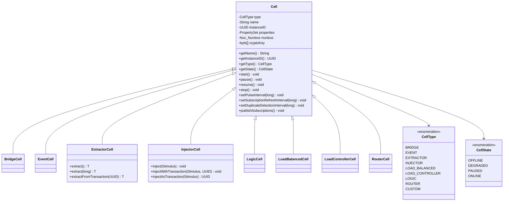
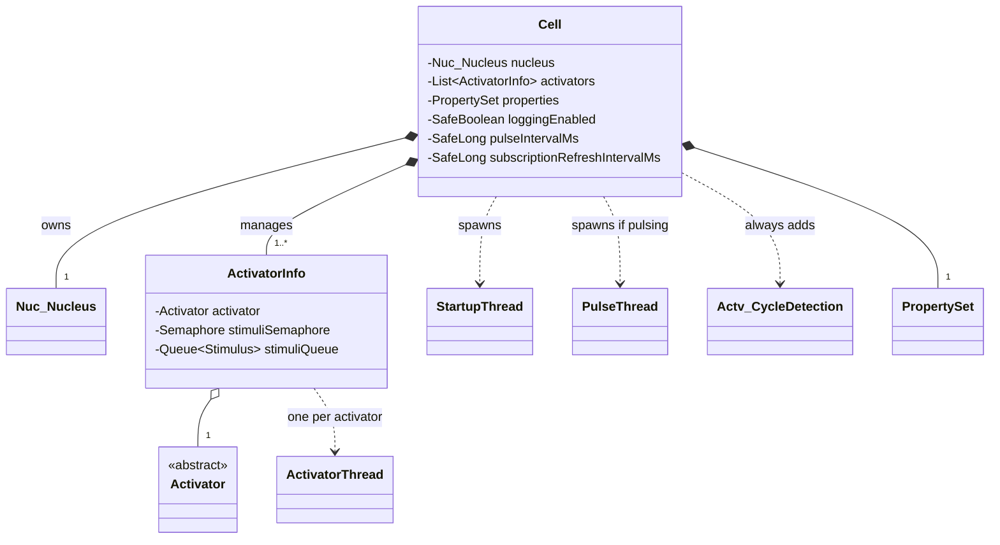
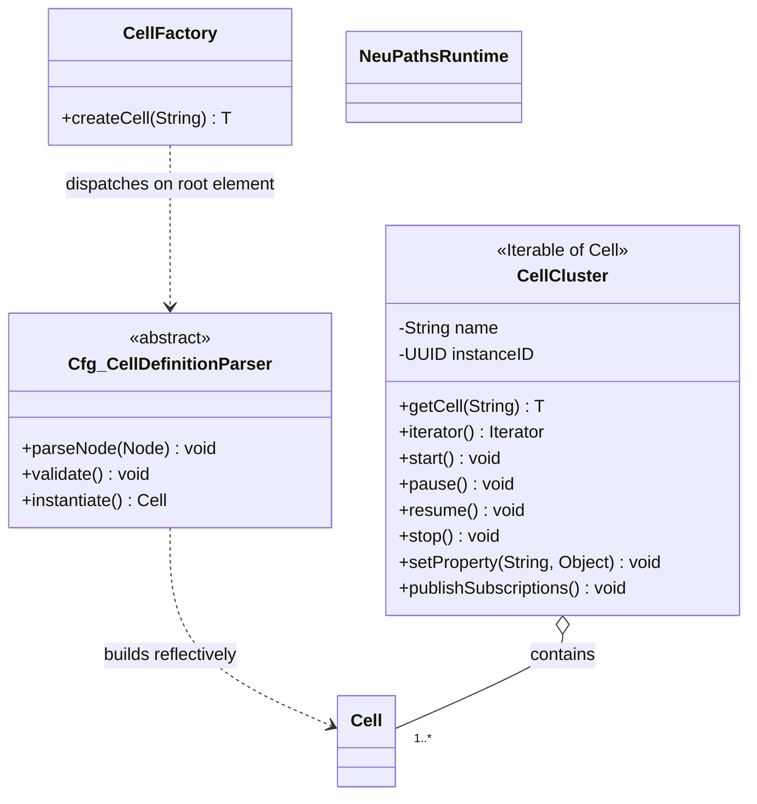
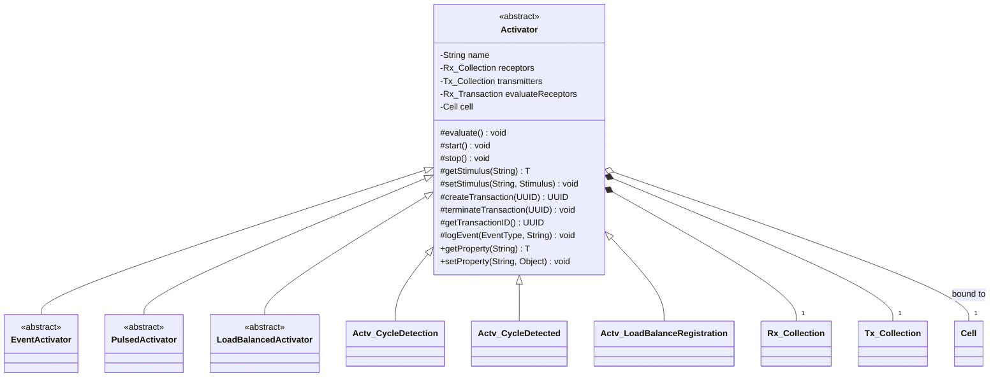
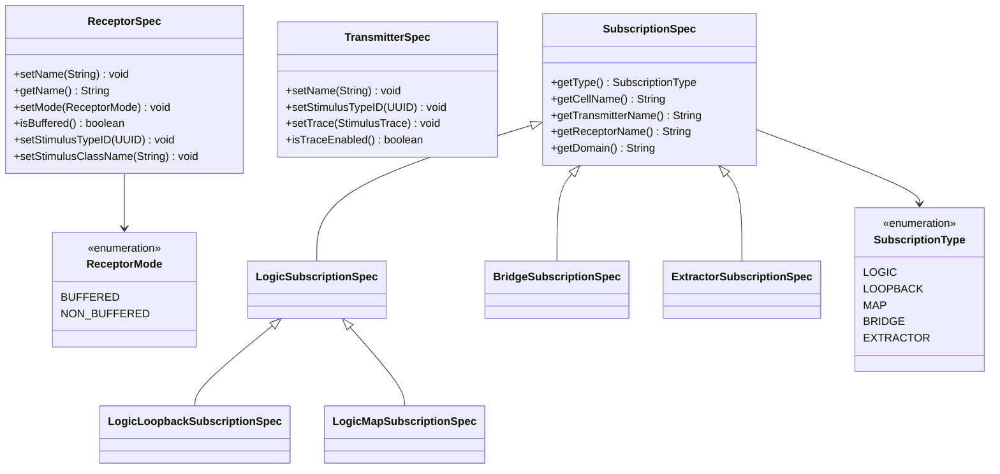
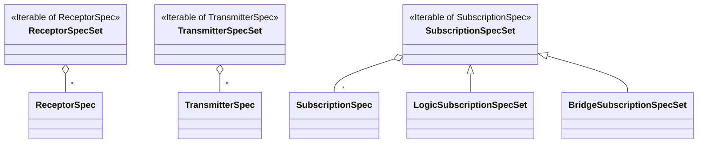
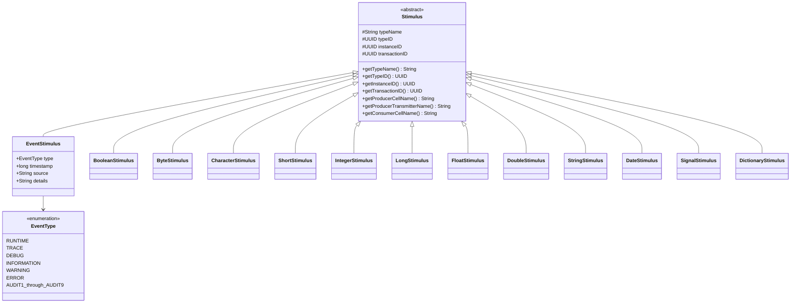

# 2 · Domain Model — Core Class Diagrams

This document models the **public API** — the types application developers work with
directly. Internal subsystems (nucleus, transport, config) are covered in
[§3](03-subsystems.md).

## 2.1 The cell type hierarchy

Eight primitive cell types extend the base `Cell`. A cell is created from an XML
definition via `CellFactory`; related cells are grouped and operated as a `CellCluster`.
A ninth `CellType` value, `CUSTOM`, tags a user-written cell derived from `LogicCell` or
`LoadBalancedCell` — there is no `CustomCell` class, the type is reported by cells you
specialize yourself.

### Role of each cell type

| Cell type | Uses activators? | Uses subscriptions? | Purpose |
|-----------|:---:|:---:|---------|
| `LogicCell` | ✅ | ✅ (Logic) | The workhorse — runs your `Activator`s to process and produce stimuli. |
| `InjectorCell` | — | — (has a transmitter) | Bridge from ordinary code *into* the mesh: `inject(stimulus)`. |
| `ExtractorCell` | — | ✅ (Extractor) | Bridge from the mesh *out to* ordinary code: `extract()`. |
| `RouterCell` | — | — | Forwards stimuli across synapses; extends reach without processing. |
| `BridgeCell` | — | ✅ (Bridge) | Moves stimuli **between domains** by maintaining presence in several. |
| `EventCell` | — | — | Collects `EventStimulus` log events for a domain (used by `EventLogger`). |
| `LoadBalancedCell` | ✅ (`LoadBalancedActivator`) | ✅ (Logic) | A worker that shares load with peers running the same activator. |
| `LoadControllerCell` | ✅ | ✅ (Logic) | Coordinator that decides which worker handles the next stimuli set. |
| *(your subclass)* | ✅ | ✅ (Logic) | A cell you derive from `LogicCell` or `LoadBalancedCell`; reports `CellType.CUSTOM`. |

## 2.2 Cell composition & lifecycle machinery

The base `Cell` composes a **Nucleus** (its routing engine) and a list of **Activators**,
and manages worker threads. A cycle-detection activator is added to *every* cell.

- Each activator gets its **own thread** (`ActivatorThread`) and a semaphore-guarded
  stimulus queue — this is what makes cells parallel by nature.
- `PulseThread` exists only when `setPulseInterval()` enabled a periodic signal; act on
  pulses by including a `PulsedActivator` (see §2.4).
- `Actv_CycleDetection` is added transparently so stimuli cannot loop forever through
  redundant paths.
- `pause()` and `resume()` are **overridable**. The base implementations flip an
  `activatorsPaused` flag, which makes `getState()` report `CellState.PAUSED` while the
  nucleus itself stays `ONLINE`/`DEGRADED` — so synapses and subscriptions survive a pause,
  only activator firing stops. A subclass that must re-announce itself on the way back
  overrides `resume()`; `LoadBalancedCell` does precisely this
  (see [§6](06-case-study-load-balancing.md)).

## 2.3 Cluster creation & runtime

- `CellFactory.createCell(defFile)` reads a cluster/cell **XML definition**, selects the
  `Cfg_*Parser` matching the root element, and lets that parser validate the definition and
  reflectively instantiate the cell, its activators, receptors and transmitters
  (see [§3.5](03-subsystems.md#35-configuration-subsystem-cfg_)).
- `CellCluster` is an `Iterable<Cell>` that applies lifecycle, tuning and property
  operations across all its member cells at once. Its public methods are `synchronized`, so
  cluster-wide operations are safe to issue from several threads; cluster-level logging,
  interval and crypto-key settings override whatever the member cells' own definition files
  specified.

## 2.4 The Activator model (dataflow logic)

`Activator` is the abstract base of all user logic. It declares typed **receptors** and
**transmitters** and a set of **logic subscriptions** that wire it to producers. The single
abstract method `evaluate()` runs when every receptor holds a stimulus.

The three public abstract subclasses are the extension points: `EventActivator` consumes
`EventStimulus`, `PulsedActivator` acts on periodic pulses, and `LoadBalancedActivator`
participates in a worker pool. The `Actv_*` subclasses are internal control-plane logic.

> **Dataflow contract.** `evaluate()` is called by the cell's activator thread only once
> **all** receptors are non-empty. The activator reads inputs with `getStimulus(receptor)`,
> computes, and emits with `setStimulus(transmitter, stimulus)`. Between firings the thread
> sleeps on a semaphore. See the activity diagram in [§4.3](04-behavior.md#43-dataflow-evaluation-activity).

### Two ways to specialize an Activator

The base constructor is `protected`:
`Activator(String name, ReceptorSpec[] receptors, TransmitterSpec[] transmitters, LogicSubscriptionSpec[] subscriptions)`.
A subclass reaches it one of two ways, and `CellFactory` instantiates whichever shape it
finds. **Both the derived class and its constructor must be `public`.**

| | **Single-expression** | **Pass-through** |
|---|---|---|
| Subclass constructor | `public MyActivator()` — no arguments; passes every spec to `super()` inline | `public MyActivator(String, ReceptorSpec[], TransmitterSpec[], LogicSubscriptionSpec[])` — forwards the factory's arguments to `super()` |
| Cell definition file | Names the class and marks it `<default/>`; the specs live in code | Spells out receptors, transmitters and subscriptions as XML |
| Pro | Much cleaner definition files; permits more complex specializations | Stimulus flow is visible to static analysis, so offline tools can document the mesh |
| Con | You must read the code to trace stimulus transmission | More verbose definition files; limits how far you can specialize |

Declaring `<default/>` is what selects the no-argument form — see
[§3.5](03-subsystems.md#35-configuration-subsystem-cfg_).

## 2.5 Receptors, transmitters & the subscription model

Activators are wired to each other by **subscriptions**. A subscription is the contract
`(producing cell C, transmitter T) ⇒ receptor R`, tagged with a **domain**. `C` and `T`
may be regular expressions, so one receptor can aggregate stimuli from many producers.

### Spec collections (the sets held by activators/cells)

| Subscription kind | Used by | Meaning |
|-------------------|---------|---------|
| `LogicSubscriptionSpec` | LogicCell, LoadBalanced/Controller | Pull stimuli to an activator's receptor for evaluation. |
| `LogicLoopbackSubscriptionSpec` | LogicCell | Feed one of the cell's own transmitters back into a receptor. |
| `LogicMapSubscriptionSpec` | LogicCell | Map/route variant of a logic subscription. |
| `BridgeSubscriptionSpec` | BridgeCell | Pull stimuli into a bridge to relay across domains (no receptor). |
| `ExtractorSubscriptionSpec` | ExtractorCell | Pull stimuli out to client code (the cell *is* the receptor). |

- **Receptor mode** `BUFFERED` queues arriving stimuli; `NON_BUFFERED` keeps only the
  latest — the choice governs back-pressure vs. freshness at each input.

### Duplicate filtering at two scopes — the redundancy primitive

The framework discards redundant arrivals at **two** levels, and the pair is what makes
redundancy composable rather than something each application re-invents:

| Scope | Where | Keyed on | Makes safe |
|-------|-------|----------|-----------|
| **Stimulus** | `Nuc_Nucleus` `stimuliHistory`, always on | stimulus instance id | Redundant **paths** — the same stimulus reaching a cell by two routes is delivered once |
| **Transaction** | `Activator.isDuplicate()`, opt-in per subscription | `(transaction, originator, stimulus, type)` | Redundant **providers** — two services answering the same request, first response wins |

Both are **time-windowed** rather than unbounded: the nucleus ages out its stimulus journal, and
the activator ages out transaction history after `transactionHistoryWindowMs` (default 30 s).
Neither grows without limit, and neither needs the application to track what it has already
seen.

Transaction filtering is opt-in because it is not always wanted — enable it with
`TransactionFilter.ENABLED` on a logic, loopback or map subscription (`<filter_transactions>` in
a cell definition; it does not apply to bridge subscriptions). The consequence is worth stating
plainly:

> Because a duplicate costs nothing, **you can afford to do the work twice.** Run two bridges so
> a dead path is invisible; run two service providers, or two load-balanced pools, so a dead
> worker is invisible. Redundancy becomes a deployment decision rather than a code change.

`examples/Transaction_Filter` demonstrates the transaction-scope case end to end, and
[§6.8](06-case-study-load-balancing.md#68-surviving-the-loss-of-a-worker) applies it to
load-balanced pools.

### Reclaiming abandoned transactions

An activator holds one **receptor bundle** per in-flight transaction, created lazily when the
first stimulus tagged with that transaction arrives. A bundle is normally discarded the moment
it has served its purpose — when it completes and the activator fires, or when a
`Stim_TerminateTransaction` arrives for it.

Some bundles never reach either. A producer dies mid-transaction; a participant joins late and
catches only part of the set; or a stimulus the bundle still needs is discarded as a duplicate
(the duplicate check runs *after* the bundle is created, so a filtered stimulus can leave an
empty bundle behind). Nothing in the dataflow model can distinguish "this will never complete"
from "this has not completed yet" — so without a sweep, those bundles would accumulate for the
life of the process.

`setTransactionMaxLifespan(ms)` caps how long one may live. The sweep runs when a stimulus
arrives for a transaction the activator has no bundle for — immediately before creating the new
one — and removes every bundle that has exceeded the limit, logging each as an `INFORMATION`
event naming the transaction id.

| | |
|---|---|
| **Default** | 60 000 ms; values below the 100 ms floor are raised to it |
| **Configure** | `setTransactionMaxLifespan()`, or `<transaction_max_lifespan_ms>` on an `<activator>` |
| **Scope** | Per activator — each holds its own bundles |
| **Never reaped** | The global (untagged) bundle, which is permanent by design |

Two consequences worth planning for:

- **Reclamation is amortized, not scheduled.** There is no reaper thread; the sweep is driven by
  the arrival of a new transaction. A cell that goes idle holding abandoned bundles keeps them
  until the next transaction arrives. Nothing grows while idle, and the cost is one pass over
  open transactions per *new* transaction rather than per stimulus — but "bounded" here means
  bounded by activity, not by wall-clock.
- **The interval is a correctness setting, not just a memory one.** It is the maximum lifespan of
  *any* bundle, so a legitimate transaction that outlives it is reaped mid-flight and its
  partial work silently dropped. Set it comfortably above the longest transaction the cell can
  legitimately take, and keep it above `transactionHistoryWindowMs` so a response arriving near
  the end of the dedup window still has a bundle to land in.

That gives the activator three independent time windows, each self-managing a different kind of
state:

| Window | Default | Bounds |
|--------|---------|--------|
| `stimuliHistory` (nucleus) | — | How long a delivered stimulus is remembered for path-level dedup |
| `transactionHistoryWindowMs` | 30 s | How long a transaction is remembered for response-level dedup |
| `transactionMaxLifespanMs` | 60 s | How long an incomplete receptor bundle may live |

## 2.6 The Stimulus model

`Stimulus` is the atomic, serializable unit of data. Each instance carries type identity,
a unique instance id, an optional transaction id, and producer/consumer metadata that the
framework fills in as the stimulus travels.

**The `neupaths.stim` pattern.** Every primitive stimulus follows the same shape: a wrapped
value, `get()`/`set()` accessors, `equals`/`hashCode`/`toString`, and two static constants —
`TYPE_NAME` (String) and `TYPE_ID` (a fixed `UUID`). The `TYPE_ID` is how the framework and
subscriptions identify stimulus types across the wire without relying on class names. New
custom stimulus types are generated with `GenerateStimulusType`, which stamps a fresh
`TYPE_ID` (see [§3.6](03-subsystems.md#36-utilities--the-daemon-control-plane)).

**`DictionaryStimulus` — the one open-ended member.** Where the other `neupaths.stim` types
wrap a single Java primitive, `DictionaryStimulus` (`final`) carries a
`HashMap<String, Object>` and exposes `get(name)`, `put(name, value)` and `entries()`. Its
`get()` is generically typed (`<T> T`) and casts on the caller's behalf, so the compiler
cannot check element types — the payload is schema-less by design, for messages whose shape
is only known at runtime. The trade is the usual one: flexibility in exchange for the static
type safety the single-value stimuli give you, and every value you put in it must itself be
serializable.

A subclass of `DictionaryStimulus` keeps the same `TYPE_ID` but takes a new type name — the
`protected DictionaryStimulus(String typeName, …)` constructors exist for exactly that, so
you can give a dictionary payload a domain-specific alias without minting a new type
identity.

> `EventType` has 15 values: `RUNTIME`, `TRACE`, `DEBUG`, `INFORMATION`, `WARNING`,
> `ERROR`, and `AUDIT1` … `AUDIT9`.

Continue to the [Subsystem class diagrams →](03-subsystems.md)
