# 3 · Subsystem Class Diagrams

These are the internal (mostly package-private) subsystems beneath the public API. Class
prefixes name the subsystem: `Nuc_` nucleus, `Syn_`/`Bnd_` transport, `Cryp_` crypto,
`Msg_` wire protocol, `Cfg_` configuration.

## 3.1 The Nucleus — per-cell routing engine (`Nuc_*`)

The `Nuc_Nucleus` is the heart of a cell. It owns the cell's binders, matches incoming
stimuli against subscriptions, filters duplicates, forwards subscriptions to peers, and
runs the send/receive worker threads. **This is what replaces the broker** — every cell
carries its own.

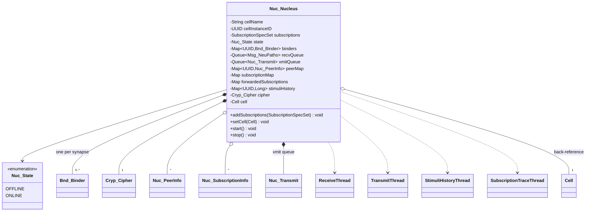

**Key responsibilities**

| Field / thread | Responsibility |
|----------------|----------------|
| `binders` | One `Bnd_Binder` per synapse; the actual network I/O endpoints. |
| `recvQueue` / `xmitQueue` + semaphores | Decouple network threads from routing; blocking queues so idle cells sleep. |
| `subscriptionMap` | Local subscriptions → which peer synapses satisfy them. |
| `forwardedSubscriptions` | Subscriptions learned from peers and re-advertised (how interest propagates across the mesh). |
| `stimuliHistory` + `StimuliHistoryThread` | Time-windowed journal of recently-seen stimulus ids → **duplicate filtering**; the window is `duplicateDetectionInterval`. |
| `SubscriptionTraceThread` | Periodically re-advertises subscriptions (`subscriptionRefreshInterval`) so the dynamic mesh stays wired. |
| `cipher` | Encrypts/decrypts each stimulus value on the wire. |

## 3.2 Transport subsystem (`Syn_*` and `Bnd_*`)

Two cooperating hierarchies: **synapses** are the raw channels (an abstraction over a JDK
NIO channel); **binders** manage the peer relationship and message framing over a synapse.

### Synapse channels & addresses

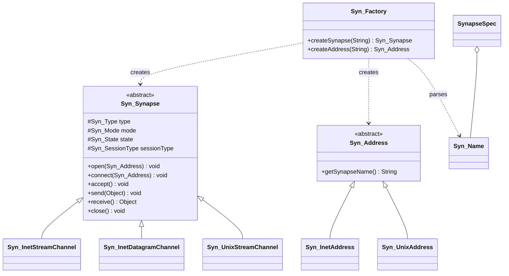

| Type | Transport |
|------|-----------|
| `Syn_InetStreamChannel` | TCP (`SocketChannel` / `ServerSocketChannel`) |
| `Syn_InetDatagramChannel` | UDP unicast and multicast (`DatagramChannel`) |
| `Syn_UnixStreamChannel` | Unix-domain stream socket (`AF_UNIX`) |
| `Syn_InetAddress` | IP host + port |
| `Syn_UnixAddress` | filesystem socket path |

### Enumerations that make up a synapse name

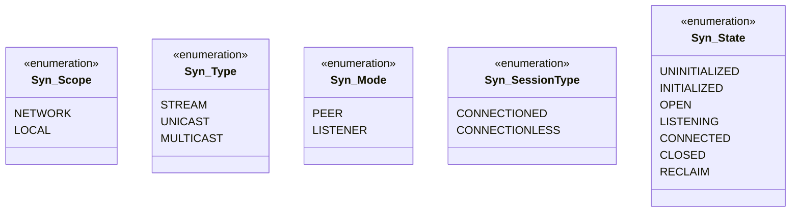

**Synapse name grammar** (from `package-info`):

```
scope # type # mode # domain [ # opt1 [ # opt2 ... ] ]

  scope   = Network | Local
  type    = Stream (TCP) | Unicast (UDP) | Multicast (UDP)
  mode    = Listener | Peer
  domain  = case-sensitive name, or "@" for the global domain
  opts    = type-specific (e.g. port, host/IP, multicast group, socket path)

Examples:
  Network#Stream#Listener#@#30001
  Network#Unicast#Peer#D1#30001#192.168.1.10
  Network#Multicast#Peer#@#30001#224.0.0.10
  Local#Stream#Listener#@#/tmp/neupaths.sock
```

### Binders — the peer relationship over a synapse

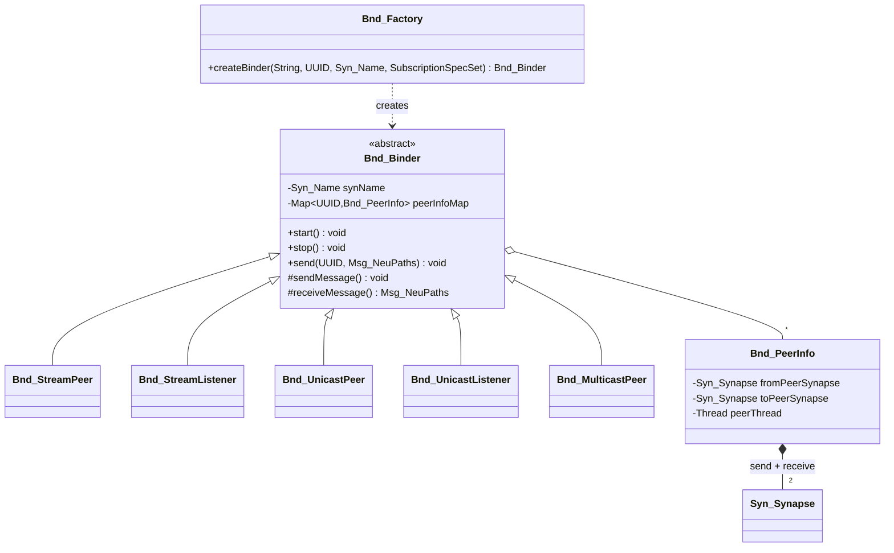

- **Listener vs Peer.** A `Listener` binder waits; when a `Peer` joins, the listener
  **spawns a new peer synapse** dedicated to that connection — the same "grow the mesh on
  contact" pattern for TCP, UDP-unicast and Unix streams.
- **Design patterns:** *Abstract Factory* (`Syn_Factory`, `Bnd_Factory`), *Strategy* (the
  synapse/binder subclasses per transport), *State* (`Syn_State` lifecycle), and the JDK
  *Cleaner* pattern for deterministic channel cleanup.

## 3.3 Cryptography subsystem (`Cryp_*`)

A pluggable cipher encrypts each stimulus value into a `javax.crypto.SealedObject` before
it crosses a synapse. The cipher is chosen by the **first byte of the crypto key**.

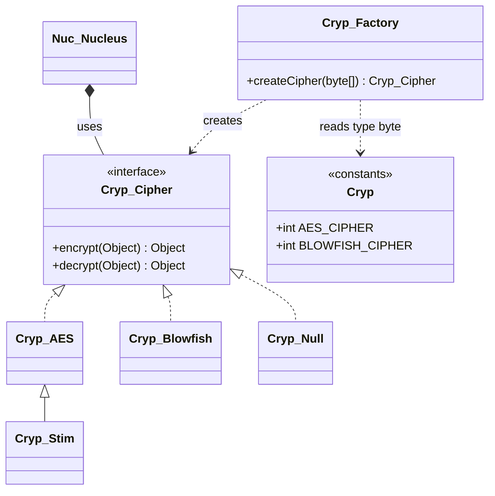

| Cipher | Algorithm |
|--------|-----------|
| `Cryp_AES` | `AES/CBC/PKCS5Padding`; first 16 key bytes are the IV. |
| `Cryp_Blowfish` | Blowfish. |
| `Cryp_Null` | Pass-through (no encryption). |
| `Cryp_Stim` | Default stimulus cipher — a fixed-key `Cryp_AES` used when no key is supplied. |

- The factory reads a type byte from the key: `Cryp.AES_CIPHER` (1) or
  `Cryp.BLOWFISH_CIPHER` (2). Supply a real key via `GenerateCryptoKey`.
- *Strategy + Factory* patterns; `Excp_Cipher` wraps all `javax.crypto` checked exceptions.

## 3.4 Wire protocol (`Msg_*`)

Everything crossing a synapse is a `Msg_NeuPaths`. One message type carries application
data (`Msg_Stimulus`); the rest form the **control plane** for the broker-less mesh:
peer join, subscription advertisement, and departure.

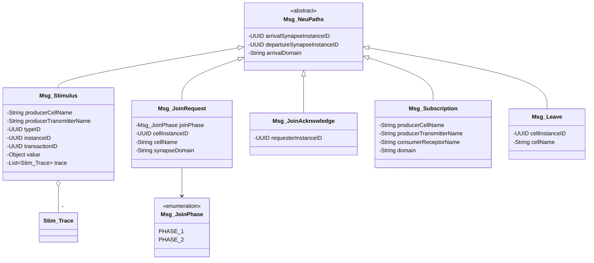

| Message | Plane | Role |
|---------|-------|------|
| `Msg_Stimulus` | data | Carries a user stimulus (value + trace) across a synapse. |
| `Msg_JoinRequest` | control | A peer advertises join intent and its send/receive synapse endpoints. |
| `Msg_JoinAcknowledge` | control | The listener reciprocates its endpoints. |
| `Msg_Subscription` | control | Declares interest in a producer's transmitter for a receptor. |
| `Msg_Leave` | control | Notifies the mesh of a departing cell so peers clean up. |

The join handshake sequence is drawn in [§4.4](04-behavior.md#44-peer-join-handshake-sequence).

## 3.5 Configuration subsystem (`Cfg_*`)

Clusters and cells are declared in **XML** and read in two distinct layers:

| Layer | Types | Job |
|-------|-------|-----|
| **Handlers** | `Cfg_ConfigHandler` and subclasses | Walk the DOM and record what the document *said*, as inert intermediate data. No reflection, no object graph. |
| **Parsers** | `Cfg_CellDefinitionParser` and subclasses | Validate that data, then reflectively build the live `Cell`, its activators, receptors and transmitters. |

Keeping the two apart is what makes the subsystem tractable: a handler is a pure
XML→fields transcription that can be read in isolation, and all the reflection, type
resolution and cross-field validation for a given cell type lives in exactly one parser.

### The parser layer

`CellFactory.createCell()` parses the document, reads the root element's name, and
dispatches to the parser registered for it. Each parser then runs the same three-step
contract.

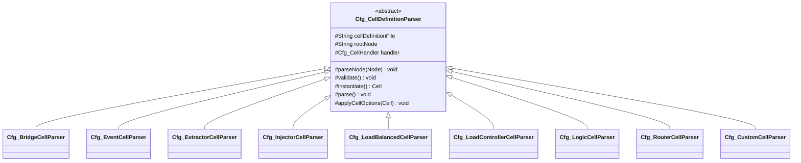

| Root element | Parser | Cell built |
|--------------|--------|-----------|
| `<bridge_cell>` | `Cfg_BridgeCellParser` | `BridgeCell` |
| `<event_cell>` | `Cfg_EventCellParser` | `EventCell` |
| `<extractor_cell>` | `Cfg_ExtractorCellParser` | `ExtractorCell` |
| `<injector_cell>` | `Cfg_InjectorCellParser` | `InjectorCell` |
| `<load_balanced_cell>` | `Cfg_LoadBalancedCellParser` | `LoadBalancedCell` |
| `<load_controller_cell>` | `Cfg_LoadControllerCellParser` | `LoadControllerCell` |
| `<logic_cell>` | `Cfg_LogicCellParser` | `LogicCell` |
| `<router_cell>` | `Cfg_RouterCellParser` | `RouterCell` |
| `<custom_cell>` | `Cfg_CustomCellParser` | your `LogicCell`/`LoadBalancedCell` subclass |

Element names are matched case-insensitively; an unrecognized root element is a
`NeuPathsException`.

**The three-step contract.** `CellFactory` calls these in order, and a failure at any step
aborts creation:

1. **`parseNode(root)`** — hands the DOM subtree to `Cfg_Utils.processElement()`, which
   drives the handler tree (below) and leaves the result in the parser's `handler` field.
2. **`validate()`** — cell-type-specific checks: required elements present, subscription
   kinds legal for this cell type, receptor/transmitter names coherent. This is where a
   malformed definition is rejected, *before* any class is loaded.
3. **`instantiate()`** — resolves each `<class>` and `<stimulus_class>` by reflection
   (`Class.forName`, then reading the type's static `TYPE_ID`), builds the `ReceptorSpec[]`
   and `TransmitterSpec[]` arrays, constructs each `Activator`, assembles the `PropertySet`,
   constructs the `Cell`, and finishes with `applyCellOptions()`.

`applyCellOptions()` lives on the base class because the option set is common, but it is
deliberately not uniform in effect:

- logging, trace, debug and runtime logging, and global subscription propagation are applied
  to every cell;
- `setSubscriptionRefreshInterval()` is skipped for `INJECTOR` and `ROUTER` cells, which hold
  no subscriptions to refresh;
- `setPulseInterval()` is applied only to `LOGIC`, `LOAD_BALANCED` and `CUSTOM` cells — the
  only types that can host a `PulsedActivator`.

### The handler layer

Handlers mirror the XML nesting. `Cfg_ConfigHandler` is the abstract base; `Cfg_CellHandler`
adds the fields every cell definition shares (name, properties, synapse names, activators,
logging flags, intervals, crypto key file).

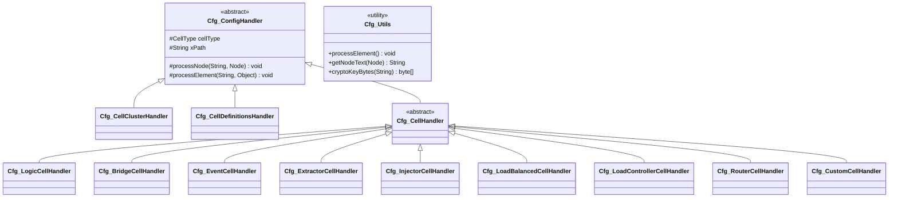

`Cfg_CellClusterHandler` parses the `<cell_cluster>` root and delegates to
`Cfg_CellDefinitionsHandler` for the list of cell-definition files; each file is then handed
back to `CellFactory` and run through its own parser.

**Handler callback interfaces** (child ⇒ parent aggregation). Every one of these passes a
*handler*, not a finished spec object — the deferral of construction to the parser layer is
visible right in the signatures:

| Interface | Callback | Implemented by |
|-----------|----------|----------------|
| `Cfg_PropertiesHandlerInt` | `addProperty(Cfg_CellPropertyHandler)` | `Cfg_CellHandler`, `Cfg_CellPropertiesHandler` |
| `Cfg_SynapsesHandlerInt` | `addSynapse(String)` | `Cfg_CellHandler` |
| `Cfg_ActivatorsHandlerInt` | `addActivator(Cfg_CellActivatorHandler)` | `Cfg_CellHandler`, `Cfg_CellActivatorsHandler` |
| `Cfg_ReceptorsHandlerInt` | `addReceptor(Cfg_CellReceptorHandler)` | `Cfg_CellReceptorsHandler`, `Cfg_CellActivatorHandler`, `Cfg_LoadControllerCellHandler` |
| `Cfg_TransmittersHandlerInt` | `addTransmitter(Cfg_CellTransmitterHandler)` | `Cfg_CellTransmittersHandler`, `Cfg_CellActivatorHandler`, `Cfg_InjectorCellHandler` |
| `Cfg_SubscriptionsHandlerInt` | `addSubscription(Cfg_CellSubscriptionHandler)` | `Cfg_CellSubscriptionsHandler`, `Cfg_CellActivatorHandler`, `Cfg_BridgeCellHandler`, `Cfg_ExtractorCellHandler`, `Cfg_LoadControllerCellHandler` |

Two groups fall out of that table. Everything a cell *always* has — properties, synapses,
activators — is implemented by `Cfg_CellHandler` on behalf of every cell type:

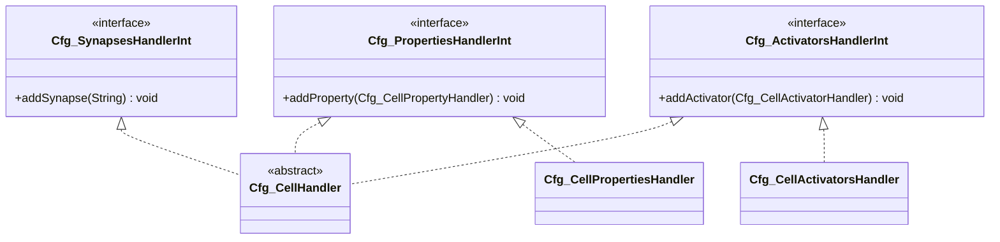

Receptors, transmitters and subscriptions are *optional* and position-dependent, so their
interfaces are implemented by the container handler, by `Cfg_CellActivatorHandler` (an
activator may declare all three), and only by those cell handlers that can carry the element
directly:

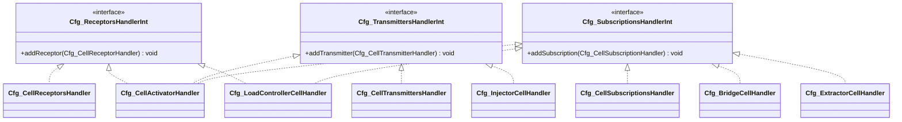

**Traversal.** `Cfg_Utils.processElement()` is the single recursion point: for each child
element it calls `handler.processNode()` to let the handler absorb that element, then
`handler.processElement()` to let the handler push itself into its parent through one of the
interfaces above. The container→item pairs (`Cfg_CellPropertiesHandler` →
`Cfg_CellPropertyHandler`, `Cfg_CellActivatorsHandler` → `Cfg_CellActivatorHandler`,
`Cfg_CellReceptorsHandler` → `Cfg_CellReceptorHandler`, `Cfg_CellTransmittersHandler` →
`Cfg_CellTransmitterHandler`, `Cfg_CellSubscriptionsHandler` →
`Cfg_CellSubscriptionHandler`) all follow this shape.

### Notable elements

An `<activator>` carries `<class>`, an optional `<name>` (defaulting to the class name), and
optional `<receptors>`, `<transmitters>` and `<subscriptions>` blocks:

| Element | Meaning |
|---------|---------|
| `<default/>` | Instantiate the activator through its **no-argument** constructor; the specs are declared in code rather than XML (see [§2.4](02-domain-model.md#two-ways-to-specialize-an-activator)). Without it, the factory looks for the full pass-through constructor. |
| `<pulse_interval_ms>` | Cell-level. Non-zero starts the cell's `PulseThread`, which is what drives a `PulsedActivator`. Honoured only by logic, load-balanced and custom cells. |
| `<transaction_history_window_ms>` | How long a transaction id stays remembered for duplicate-response filtering, defaulting to 30 000 ms. Accepted on an `<extractor_cell>` (applied to the cell) and on an `<activator>` of a load-balanced or custom cell (applied to that activator). |
| `<filter_transactions>` | `enabled`/`disabled` on a logic, loopback or map subscription — discards redundant responses for a transaction already answered. Not applicable to bridge subscriptions. |
| `<trace>` | `enabled`/`disabled` on a transmitter; turns on per-stimulus tracing for that output. |

`Cfg_CellSubscriptionsHandler` resolves the subscription kind from the element name —
`<bridge_subscription>`, `<extractor_subscription>`, `<logic_subscription>`,
`<loopback_subscription>` and `<map_subscription>` name their type explicitly, while a plain
`<subscription>` is interpreted according to the enclosing cell type (bridge for a bridge
cell, extractor for an extractor cell, logic for logic, load-balanced, load-controller and
custom cells).

## 3.6 Utilities & the daemon control plane (`neupaths.util`)

Command-line tools and a background **daemon** for operating clusters. The daemon itself is
built *from NeuPaths cells* — the control plane eats its own dog food.

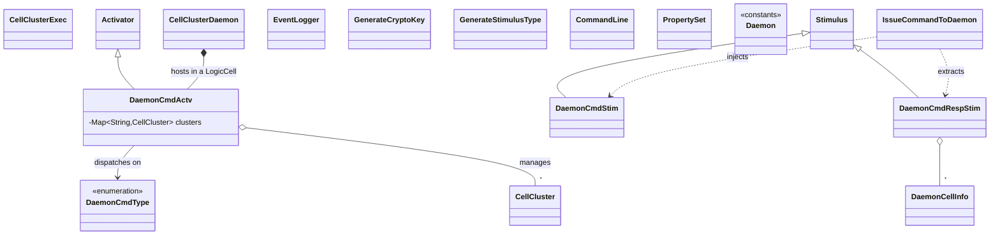

The six CLI entry points (each has a `main()`): `CellClusterExec`, `CellClusterDaemon`,
`IssueCommandToDaemon`, `EventLogger`, `GenerateCryptoKey`, `GenerateStimulusType`.
`DaemonCmdStim`/`DaemonCmdRespStim` are `Stimulus` subclasses; `DaemonCmdActv` is an
`Activator`; `PropertySet` is a thread-safe, serializable, iterable name/value map used for
arguments and cell properties throughout.

**Control-plane flow.** `CellClusterDaemon` hosts a `LogicCell` whose `DaemonCmdActv`
listens for `DaemonCmdStim` commands (discover / deploy / start / pause / stop / logging —
33 in `DaemonCmdType`). `IssueCommandToDaemon` uses an `InjectorCell` to send a command and
an `ExtractorCell` to receive the `DaemonCmdRespStim` — i.e. the operator tooling is itself
an ordinary NeuPaths client talking over synapses, with no privileged backchannel.

## 3.7 Exception hierarchy

Two roots: a checked `Excp_NeuPaths` family used internally by subsystems, and a single
unchecked `NeuPathsException` surfaced to API callers.

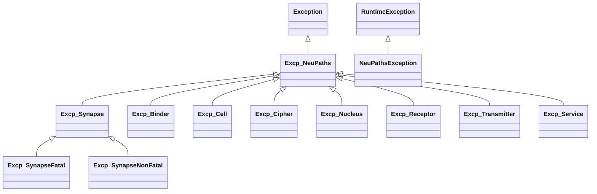

- Internal subsystems throw specific checked `Excp_*` types; boundaries (e.g. `Cell`,
  `Activator`) translate failures into the unchecked `NeuPathsException` for callers.
- `Excp_SynapseFatal` vs `Excp_SynapseNonFatal` lets the transport distinguish a dead
  connection (tear down) from a recoverable hiccup (retry) — key to mesh resilience.

Continue to the [Behavioral diagrams →](04-behavior.md)
