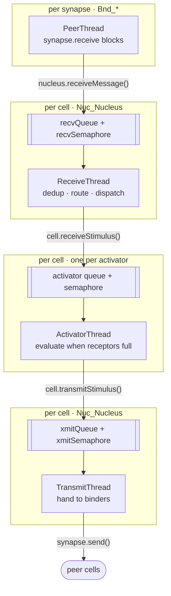
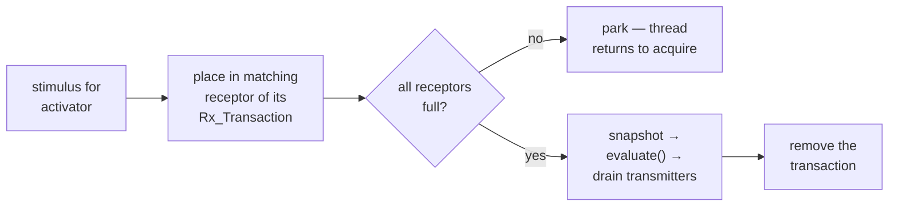

# 5 · Execution Model — Threads & Dataflow

NeuPaths is **thread-per-role**, not thread-per-request. A stimulus is handed across a series
of in-memory queues, and a dedicated thread owns each stage. This is what makes the framework
*parallel by nature* (independent stages and independent cells run at once) yet *asleep when
idle* (every consumer blocks on a semaphore until work arrives — no polling, no spinning).

## 5.1 The handoff idiom

Every stage boundary uses the same construct: a `LinkedList` guarded by a **fair**
`ReentrantLock(true)`, paired with a counting **`Semaphore(0, true)`** that signals "data
available." A producer enqueues under the lock and calls `release()`; a consumer calls
`acquire()` (blocking when the queue is empty), then dequeues under the lock.

```java
// producer                              // consumer
mutex.lock();                            semaphore.acquire();   // sleeps here when idle
try   { queue.addLast(item); }           mutex.lock();
finally { mutex.unlock(); }              try   { item = queue.pollFirst(); }
semaphore.release();                     finally { mutex.unlock(); }
```

Because the consumer parks inside `acquire()`, an idle cell consumes no CPU. Fairness on both
the lock and the semaphore preserves **FIFO order within a single queue**.

## 5.2 The pipeline



Walking the path:

1. A binder **`PeerThread`** blocks on `synapse.receive()`; on a message it calls
   `nucleus.receiveMessage(msg)`, which enqueues to `recvQueue` and releases `recvSemaphore`.
2. The single **`ReceiveThread`** drains `recvQueue`, runs duplicate detection against the
   `stimuliHistory` journal, routes/forwards, and for a matched `Msg_Stimulus` calls
   `cell.receiveStimulus()`.
3. `receiveStimulus()` **fans out**: for every activator whose `isInterested()` returns true,
   it calls `activatorThread.announceStimulus()`, enqueuing to *that activator's private queue*.
4. Each **`ActivatorThread`** drains its own queue and calls `evaluateStimulus()`.
5. When the activator's inputs are complete (§5.4) your `evaluate()` runs; outputs are drained
   from the transmitters via `cell.transmitStimulus()`, which enqueues to `xmitQueue`.
6. The single **`TransmitThread`** drains `xmitQueue` and hands each message to the binders,
   which `synapse.send()` to peers.

The single `ReceiveThread` (inbound) and single `TransmitThread` (outbound) act as
**serialization points** per cell — duplicate detection and routing need no hot-path locking
beyond the history mutex, and outbound ordering is well-defined.

## 5.3 Thread inventory

Threads present in one running cell:

| Thread | Scope | Count | Lifetime | Responsibility |
|--------|-------|:-----:|----------|----------------|
| `ActivatorThread` | Cell | **1 per activator** | long-lived | Drains the activator's queue and runs `evaluateStimulus()` → `evaluate()`. Priority `NORM_PRIORITY + 2`. |
| `StartupThread` | Cell | 1 per activator | transient | Sleeps `1.1 × subscriptionRefreshInterval` (or `1000 ms` when refresh is disabled), then starts the activator + its `ActivatorThread`, posts initial stimuli, and exits. Staggers startup so subscriptions propagate first. |
| `PulseThread` | Cell | 0 or 1 | long-lived | Emits a periodic `DateStimulus`; exists only when `setPulseInterval(> 0)`. |
| `ReceiveThread` | Nucleus | 1 | long-lived | Inbound serializer: dedup, route/forward, dispatch to activators. |
| `TransmitThread` | Nucleus | 1 | long-lived | Outbound serializer: drain `xmitQueue`, hand to binders. |
| `StimuliHistoryThread` | Nucleus | 1 | long-lived | Evicts expired ids from the duplicate-detection journal (the `duplicateDetectionInterval` window). |
| `SubscriptionTraceThread` | Nucleus | 0 or 1 | long-lived | Periodic subscription tracing (only if that interval is set). |
| `ListenThread` | Binder | 1 per listener synapse | long-lived | Accepts joins; spawns a `PeerThread` per connection. |
| `PeerThread` | Binder | 1 per connected peer | long-lived | Blocks on `synapse.receive()`; calls `nucleus.receiveMessage()`. |
| `SubscriptionRefreshThread` | Binder | 1 per binder | long-lived | Periodically re-advertises this cell's subscriptions to peers — keeps the dynamic mesh wired and self-healing. |

> **Rough count.** A cell with **A** activators and **P** live peer connections runs about
> **A** activator threads + **4** nucleus threads + per-binder threads (`listener + P peers +
> refresh`). Every cell auto-adds an `Actv_CycleDetection`, so `A ≥ 1` always. Independent
> cells share no state and run fully concurrently.

## 5.4 The dataflow gate

The firing rule lives in `Activator.evaluateStimulus()`. Incoming stimuli are placed into an
**`Rx_Transaction`** — a bundle of receptors keyed by `transactionID`. Each stimulus fills its
matching receptor; `evaluate()` runs **only** when `transaction.isComplete()`, i.e. *every*
receptor holds a stimulus.



Keying by `transactionID` means **several half-complete input sets can be assembled
concurrently** — a neuron waiting on three signals can hold multiple partial bundles in flight,
each completing independently. A `MAP` subscription keys the receptor slot by producing
transmitter name instead of receptor name, letting one receptor gather many producers.

## 5.5 Properties & guarantees

| Property | Behavior |
|----------|----------|
| **Ordering** | FIFO *within* a single activator's queue (fair lock + fair semaphore). **No** global ordering across activators, and **no** cross-cell ordering. |
| **Parallelism** | Activators within a cell run concurrently (one thread each); independent cells are fully independent. |
| **Duplicate safety** | The single `ReceiveThread` checks a time-windowed `stimuliHistory` map before routing, so the same stimulus arriving by two mesh paths is delivered once. |
| **Synchronization** | Fine-grained fair locks — separate mutexes for `recvQueue`, `xmitQueue`, `peerMap`, `subscriptionMap`, `forwardedSubscriptions`, `stimuliHistory`. Flags/tunables use `SynchronizedValue<T>` (`SafeBoolean`, `SafeLong`) with `synchronized` accessors. |
| **Priority** | `ActivatorThread` runs at `NORM_PRIORITY + 2` so evaluation keeps pace with I/O threads. |

## 5.6 Pause semantics

`Cell.pause()` **suspends processing of stimuli** — it is not a buffer.

While paused, the `ActivatorThread` keeps draining its queue: it accepts each stimulus and
simply skips `evaluateStimulus()`. Stimuli that arrive during the pause are therefore consumed
and discarded, not held for `resume()`. Deferring them would risk replaying stimuli into
already-completed transactions and other temporal errors, so the framework drops them by
design.

Two useful consequences: the activator's queue stays bounded for the duration of the pause,
and the thread still parks in `acquire()` between stimuli rather than polling.

`resume()` clears the flag and evaluation continues with whatever arrives next. Use pause to
quiesce a cell, not to hold work for later.

**Pause is an activator-level state, not a transport-level one.** `pause()` sets an
`activatorsPaused` flag and nothing else; the nucleus keeps running, so synapses stay
connected, subscriptions keep refreshing and peers see no disconnect. `getState()` *derives*
the answer — it reads the nucleus state and reports `PAUSED` only when the nucleus is
`ONLINE` or `DEGRADED` and the flag is set. Two consequences fall out of that ordering:

- `pause()` and `resume()` are no-ops on a cell that is `OFFLINE`, since there is nothing to
  suspend; and
- an `OFFLINE` or `DEGRADED` nucleus state always wins in `getState()`'s report, so a paused
  cell that then loses its peers reports the transport problem rather than hiding it behind
  `PAUSED`.

**Both methods are overridable** (`getState()` is not). A subclass that must re-announce
itself to the mesh on the way back overrides `resume()`, calls `super.resume()` and then
transmits — which is exactly how a `LoadBalancedCell` rejoins its controller's worker pool
(see [§6](06-case-study-load-balancing.md)).

## 5.7 Sharp edges

- **No backpressure.** All queues are unbounded `LinkedList`s. A slow activator grows its own
  queue without throttling upstream — watch this under sustained overload.

  Two clarifications, because this edge is easy to mistake for one the framework already
  handles. First, **the load-balancing credit mechanism is not backpressure.** Work stimuli are
  broadcast to every worker and fill their receptors on arrival; the credit gates *evaluation*,
  not *admission* (see [§6.4](06-case-study-load-balancing.md), phase 2 — every worker "sits
  holding the work"). The producer is never slowed by a credit shortage. Second, **redundancy
  does not help here either.** Duplicate filtering at either scope addresses *independent*
  failure; saturation is a *common-mode* failure, so two pools fed the same requests fall behind
  identically and simultaneously while consuming 2× the resources.

  Mitigate by design instead: bound the arrival rate at the injector, size `BUFFERED` receptors
  against the worst-case burst, or prefer `NON_BUFFERED` where only the latest value matters.
- **Abandoned transaction bundles are bounded, but by activity rather than by clock.** An
  activator's receptor bundle for a transaction that never completes is reclaimed by the
  transaction reaper (`transactionReapIntervalMs`, default 60 s — see
  [§2.5](02-domain-model.md#reclaiming-abandoned-transactions)). There is no reaper thread: the
  sweep is triggered by the arrival of a *new* transaction, so a cell that falls idle holding
  abandoned bundles keeps them until traffic resumes. Memory does not grow while idle, but it is
  not released either. The interval doubles as the maximum lifespan of *any* bundle, so set it
  above the longest transaction the cell can legitimately take.
- **Shutdown.** `stop()` sets `SafeBoolean` terminate flags and `interrupt()`s each thread to
  break it out of `acquire()`/`sleep()`, then drains permits and clears queues. Threads are
  **daemon by default** (the JVM can exit) unless the env var
  `NEUPATHS_FORCE_GRACEFUL_TERMINATION` is set, which makes them non-daemon for clean joins.

Continue to the [Case Study — Load Balancing →](06-case-study-load-balancing.md)
